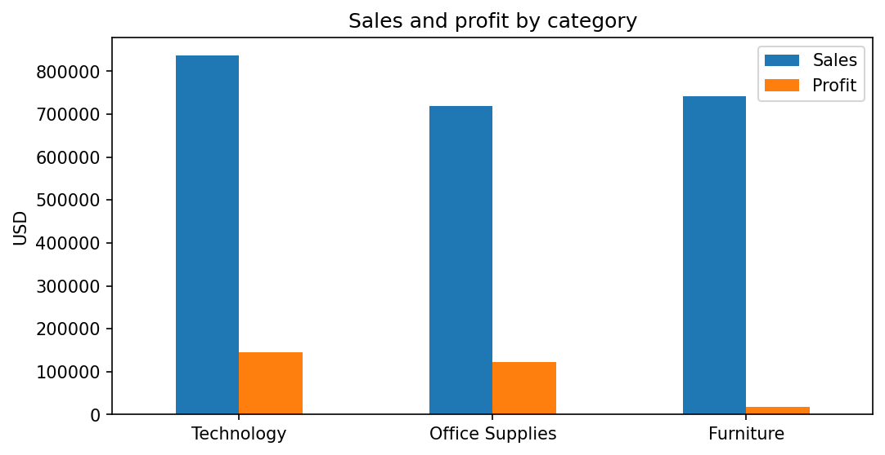
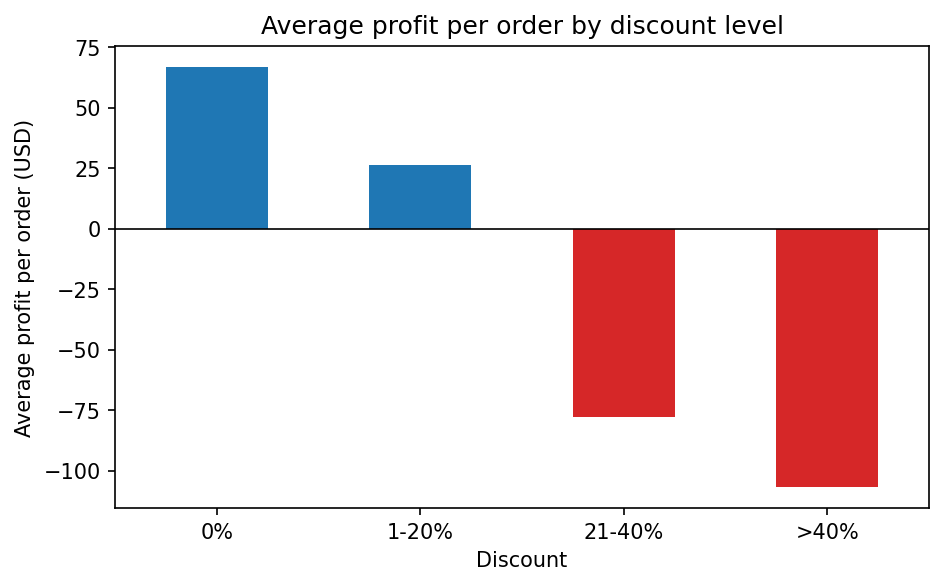
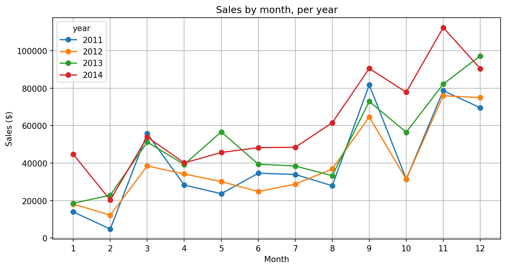

# Superstore Sales Analysis

## Goal
Analysis of Superstore sales to find what drives profit and losses. The project answers four business questions: which product category earns the most, which regions and states lose money (and why), which best-selling products are actually profitable, and how sales change over time.

## Data
- **Source:** [Superstore Sales](https://www.kaggle.com/datasets/ishanshrivastava28/superstore-sales) dataset on Kaggle (downloaded automatically with `kagglehub`; the data file is not stored in this repository).
- **Size:** 9,994 rows, 21 columns (orders from 2011–2014).
- **Quality checks:** no missing values, no duplicated rows; `Order Date` and `Ship Date` converted to datetime.
- **Totals:** sales ≈ $2.30M, profit ≈ $286k.

## Key findings
- Technology and Office Supplies drive profit; Furniture has high sales, low profit (2.5% margin).
- All regions are profitable, but Central has the lowest margin (7.9%) and the highest discounts (24% on average).
- Losses start at 21-40% discount (avg -$77.9 per order) and deepen above 40% (avg -$106.7); the biggest loss-making states are Texas, Ohio and Pennsylvania.
- 3 of the 10 best-selling products lose money.
- Sales are seasonal and trend upward (≈ $484k in 2011 to ≈ $734k in 2014, with a small dip in 2012); they peak in September and November every year.

## Charts

**Sales and profit by category**



**Average profit per order by discount level**



**Sales by month, per year**



## Tools
Python, pandas, matplotlib, Jupyter Notebook, kagglehub

## How to run
1. Clone the repository and go to its folder:
   ```bash
   git clone <repository-url>
   cd superstore-sales-analysis
   ```
2. Install the dependencies:
   ```bash
   pip install -r requirements.txt
   ```
3. Open the notebook and run all cells (the dataset is downloaded on the first run; Kaggle may ask for credentials if your setup requires them):
   ```bash
   jupyter notebook superstore_analysis.ipynb
   ```

The charts are saved to the `images/` folder when the notebook runs.

## Project structure
```
superstore-sales-analysis/
├── superstore_analysis.ipynb   # analysis
├── images/                     # saved charts used in this README
├── requirements.txt
└── README.md
```
